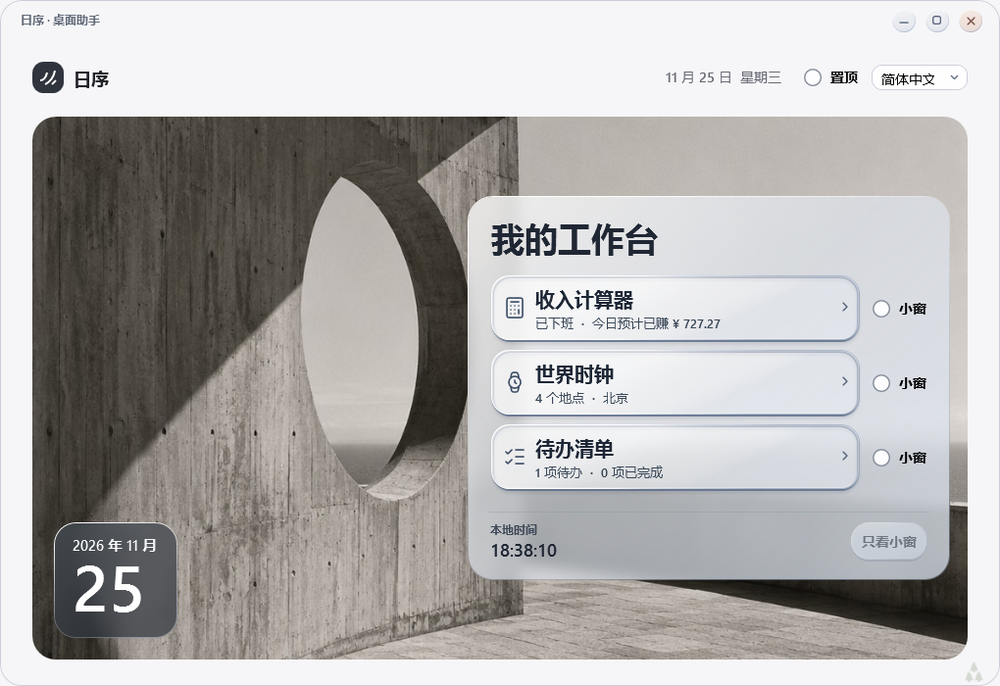
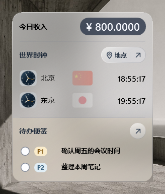

# 日序 · RiXu

日序是一个离线运行的 Windows 桌面助手。打开工作台，选一件现在要做的事，也可以把它收成桌面上的小窗。



## 获取与运行

从 GitHub 的 **Code → Download ZIP** 下载并解压源码，或使用 Git 克隆仓库。按下方[构建说明](#从源码构建)生成 `日序.exe`，双击运行。适用于安装了 .NET Framework 4.8 的 Windows 10/11 桌面环境。

| 工具 | 完整窗口 | 缩小模式 |
| --- | --- | --- |
| 收入计算器 | 根据月薪、计薪天数、上下班时间和午休时段，按秒估算今日收入，显示下班倒计时 | 只显示金额的胶囊 |
| 世界时钟 | 搜索国家、地区或城市，收藏地点并切换数字时钟和指针表盘 | 自选要显示的几个地点 |
| 待办清单 | 添加和勾选任务，配合 25 分钟专注计时 | 可以直接勾选的桌面便签 |

在工具页点击「缩小模式」进入置顶小窗。拖动可移动，按 Esc 返回原页面。首次使用收入计算器时，请先打开「薪资设置」。估算支持同日班次，可选择只计工作日或每天计薪。



## 本地数据

薪资设置、待办、时钟收藏和表盘偏好保存在当前 Windows 用户的 `%LOCALAPPDATA%\RiXuDesk\desk.xml`。备份时先关闭日序，再复制该文件。截图中的金额与任务均为演示数据。

## 从源码构建

在 64 位 Windows 上安装或启用 .NET Framework 4.8，然后在仓库根目录用 PowerShell 运行：

```powershell
.\Build.ps1
```

输出为根目录下的 `日序.exe`。构建脚本使用系统的 .NET Framework C# 编译器，将 WPF 界面、封面、地点表和时区规则嵌入可执行文件。

## 素材、时区数据与许可

- 日序的原创代码使用 [MIT License](LICENSE)。首页封面为本项目生成的建筑摄影风格图像。
- 线性图标基于 Lucide。相关 ISC 与 MIT 版权声明见 [Lucide 许可](Lucide-LICENSE.txt)。
- 地点名称使用 Unicode CLDR 数据，许可见 [Unicode License v3](Unicode-LICENSE.txt)。
- 地点与 UTC 偏移规则来自 [IANA Time Zone Database](https://www.iana.org/time-zones)。当前内置数据取自 tzdata 2026.6（IANA 2026f）。各地变更夏令时政策后，需要随新版本更新规则。
