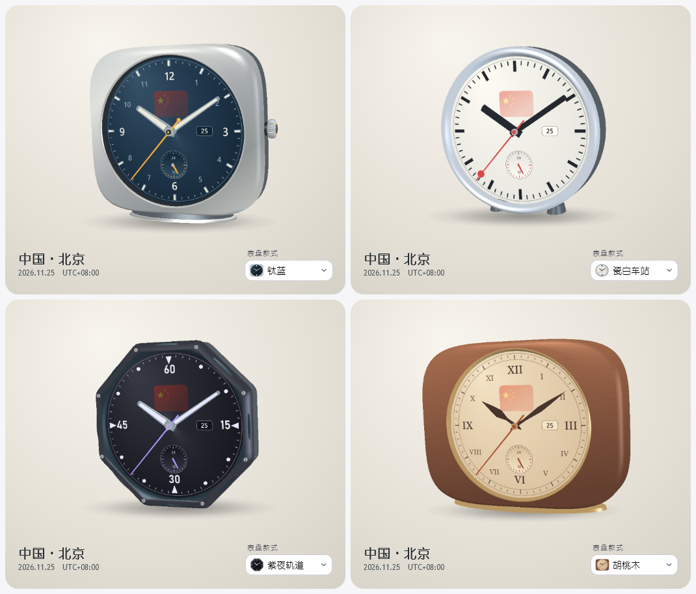

# 日序 · RiXu

日序是一个离线运行的 Windows 桌面助手。打开工作台，选一件现在要做的事，也可以把它收成桌面上的小窗。


## 获取与运行

从 GitHub 的 **Code → Download ZIP** 下载并解压源码，或使用 Git 克隆仓库。按下方[构建说明](#从源码构建)生成 `日序.exe`，双击运行。适用于安装了 .NET Framework 4.8 的 Windows 10/11 桌面环境。

| 工具 | 完整窗口 | 缩小模式 |
| --- | --- | --- |
| 收入计算器 | 根据月薪、计薪天数、上下班时间和午休时段，按秒估算今日收入，显示下班倒计时 | 只显示金额的胶囊 |
| 世界时钟 | 搜索国家、地区或城市，收藏地点并切换数字时钟和指针表盘 | 自选要显示的几个地点 |
| 待办清单 | 添加和勾选任务，配合 25 分钟专注计时 | 可以直接勾选的桌面便签 |

在工作台勾选各工具右侧的「小窗」。只选收入时，桌面上会显示一个金额胶囊。选中时钟和待办时，时钟在上、便签在下，拖动空白处就能一起移动。再勾选收入，金额胶囊会出现在顶部。点「只看小窗」可最小化工作台。在某一区域点 ↗ 或双击空白处可展开对应工具，其余工具继续留在小窗中。取消最后一项时小窗关闭，下次启动会恢复上次的选择。

在收入计算器的「薪资设置 → 工作日历」中，切到目标月份，点选实际上班的日期，也可先选周一至五，再调整补班或休假。该月的日薪按月薪除以选中的工作日数估算，休息日收入为零。各月独立保存，未排班的月份沿用「薪资与班次」中的通用规则。

在「薪资与班次 → 薪资币种」选择发薪货币，或在展开的列表中键入 USD、HKD、JPY 等代码定位。按所选币种填写月薪，切换币种时保留月薪数值。工作台、收入页和收入小窗会同步显示所选币种。

在「薪资与班次」设置午休开始时间和每天的午休分钟数，填 0 即全天连续计薪。在工作日历点「指定日期的午休…」可单独调整某一天。午休期间收入暂停累加，下班时累计到当天的日薪。

小窗会透出并模糊背后的桌面或窗口。时钟右上角的定位图标和「地点」用来选择城市，旁边的箭头用来展开工具。关闭 Windows 的「透明效果」后，小窗会使用实色底板。


右上角的语言菜单可随时切换简体中文或 English，已打开的小窗会同步切换。程序会记住选择，任务内容保留输入时的文字。

在「世界时钟 → 指针表盘」右下角的「表盘款式」可以选择钛蓝、瓷白车站、紫夜轨道或胡桃木。四款各有自己的表壳、指针和刻度，按住拖动可查看立体细节。日期窗和 24 小时副盘使用所选城市的当地时间。时钟小窗同步使用对应的简化表盘，下次打开也会记住款式。关闭 Windows 动画效果后，表壳保持固定角度，指针逐秒走时。



在待办页点「安排任务…」，或点已有任务旁的「编辑」。点击「计划开始」或「计划结束」下方的日期栏会弹出日历，选好日期后从下拉列表选择小时和分钟。起止时间均可留空，也可跨日；点对应行的 × 可清除时间。勾选后按本地完成时间归档。「完成记录」可以按日、周（周一至周日）或自然月回看。已完成事项移出清单后仍保留记录，取消勾选会撤销该次完成。旧版缺少时间的完成项归入「日期未知」。

## 本地数据

薪资设置、待办、时钟收藏和表盘偏好保存在当前 Windows 用户的 `%LOCALAPPDATA%\RiXuDesk\desk.xml`。备份时先关闭日序，再复制该文件。截图中的金额与任务均为演示数据。

## 从源码构建

在 64 位 Windows 上安装或启用 .NET Framework 4.8，然后在仓库根目录用 PowerShell 运行：

```powershell
.\Build.ps1
```

输出为根目录下的 `日序.exe`。构建脚本使用系统的 .NET Framework C# 编译器，将 WPF 界面、封面、地点表和时区规则嵌入可执行文件。

表壳和指针使用 Three.js 建模，网格已作为 `TravelClock.mesh.gz` 随源码提供。日常构建和使用均可离线完成。需要修改模型时，安装 Node.js 后运行以下命令重新生成网格，再运行构建脚本。

```powershell
npm install --prefix .release/clock-art --no-audit --no-fund --ignore-scripts three@0.180.0
node tools/build-travel-clock.mjs .release/clock-art/node_modules/three/build/three.module.js
```

## 素材、时区数据与许可

- 日序的原创代码使用 [MIT License](LICENSE)。首页封面为本项目生成的建筑摄影风格图像。
- 世界时钟支持指针、电子和无表盘列表。地点旗帜使用内置的 [Twemoji](https://github.com/jdecked/twemoji) 国旗 emoji，按地点代码匹配，采用 [CC BY 4.0](https://creativecommons.org/licenses/by/4.0/) 许可，详见 [素材署名](Flag-Attribution.txt)。
- 右下角的「三木」水印由三枚 Twemoji 常青树（🌲）排成「森」，使用 Three.js 制作浅浮雕并预渲染为透明图像。[素材署名与改动说明](Flag-Attribution.txt)
- 线性图标基于 Lucide。相关 ISC 与 MIT 版权声明见 [Lucide 许可](Lucide-LICENSE.txt)。
- 地点名称及内置货币的中英文名称、符号和金额小数位使用 Unicode CLDR 数据，许可见 [Unicode License v3](Unicode-LICENSE.txt)。
- 地点与 UTC 偏移规则来自 [IANA Time Zone Database](https://www.iana.org/time-zones)。当前内置数据取自 tzdata 2026.6（IANA 2026f）。各地变更夏令时政策后，需要随新版本更新规则。
